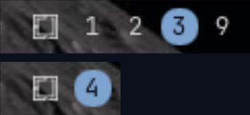

# omarchy-plugin-workspaces

A workspaces bar widget for the [Omarchy](https://omarchy.org/) shell,
cloned from the built-in `omarchy.workspaces`.

## What it does

- Each monitor's bar only lists the workspaces in use on that monitor.
- Keeps the number visible on the workspace open on that monitor, over
  a badge in the theme's accent color.
- Click a workspace to focus it.

## Preview



## Install

```bash
omarchy plugin add https://github.com/vinicgobbi/omarchy-plugin-workspaces.git --enable
```

Enabling it replaces the built-in `omarchy.workspaces` in the same bar
position; disabling it puts the built-in back.

## Update

```bash
omarchy plugin update vinicgobbi.workspaces
```

## Uninstall

```bash
omarchy plugin remove vinicgobbi.workspaces
```

## Contributing

See [CONTRIBUTING.md](CONTRIBUTING.md) for local setup, the plugin's
file structure, and the commit/release process.

## License

[MIT](LICENSE)
